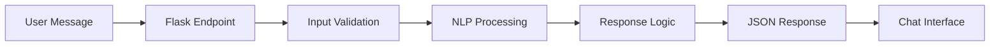

<div align="center">


<br/>


<br/><br/>

<a href="https://share.google/llzm8hnakE0NjSiUz"></a>
&nbsp;
<a href="https://share.google/llzm8hnakE0NjSiUz"></a>
&nbsp;
<a href="https://share.google/llzm8hnakE0NjSiUz"></a>

<br/><br/>


</div>

---

## 💬 Conversations Meet Code

**NLP Chatbot Python Flask** is a project concept centered on building conversational applications with Python, natural language processing (NLP), and the Flask web framework. It provides a starting point for exploring how user messages can flow from a web interface to language-processing logic and back as useful responses.

Whether you're learning backend development, prototyping a support assistant, or experimenting with language understanding, this project theme connects practical web development with conversational AI.

> **The idea:** Keep the web layer simple, the NLP logic modular, and the conversation experience easy to improve.

## 🧭 At a Glance

| 🐍 Python | 🌐 Flask | 🧠 NLP | 🔌 Integration |
|:---:|:---:|:---:|:---:|
| Application logic | Web routes and APIs | Message processing | Connect a chat UI or client |

## ✨ What You Can Build

| Project direction | Description | Why it matters |
|:---|:---|:---|
| **FAQ Assistant** | Match user questions to helpful answers | Explore intent handling |
| **Support Chat Prototype** | Build a conversational help flow | Practice dialogue design |
| **Knowledge-Based Bot** | Connect responses to approved reference content | Improve answer relevance |
| **Learning Companion** | Create guided question-and-answer interactions | Experiment with feedback loops |
| **Chat API** | Expose conversation endpoints through Flask | Connect web or mobile frontends |

*These are suggested applications, not verified features of a specific downloadable build.*

---

## 🏗️ Conceptual Architecture



The exact NLP implementation can vary: rules, intent classifiers, retrieval systems, or language models can all fit behind the processing layer.

## 🖥️ Interface Preview

<div align="center">


</div>

---

## 🚀 Quick Start — General Flask Workflow

The following is a **generic development workflow**, not a verified installation guide for the linked package.

**1. Prepare your environment**

```bash
python -m venv .venv
```

Activate the virtual environment using the command appropriate for your operating system.

**2. Install dependencies**

If the project includes a `requirements.txt` file:

```bash
pip install -r requirements.txt
```

**3. Review configuration**

Check the repository for environment variables, NLP model files, and any setup instructions. Do not commit API keys or secrets.

**4. Start the Flask application**

Use the entry point documented by the actual project. For a conventional Flask app exposing an `app` object in `app.py`, a common development command is:

```bash
flask --app app run --debug
```

> Debug mode is for local development only. Use a production-ready server and appropriate security settings for deployment.

---

## 🧩 Design Priorities

| Priority | Recommended approach |
|:---|:---|
| **Clear API boundaries** | Separate HTTP request handling from NLP processing |
| **Safe input handling** | Validate and limit incoming text |
| **Reliable responses** | Handle empty, unsupported, and ambiguous messages |
| **Maintainability** | Keep conversation logic in testable modules |
| **Privacy** | Minimize stored chat data and protect secrets |
| **Observability** | Log errors without unnecessarily recording sensitive messages |

## 🛠️ Developer Tips

- Start with a small set of supported intents before adding more complex NLP models.
- Test how the chatbot responds to typos, short messages, and unexpected input.
- Use structured JSON responses to simplify frontend integration.
- Keep training or reference data separate from Flask route handlers.
- Evaluate accuracy and latency with representative test conversations.

---

## ❓ Frequently Asked Questions

<details>
<summary><b>What does NLP mean?</b></summary>

Natural language processing is a field of computing focused on working with human language, including text analysis and language generation.
</details>

<details>
<summary><b>Why use Flask for a chatbot?</b></summary>

Flask is a lightweight Python web framework that can expose endpoints for sending messages and returning responses.
</details>

<details>
<summary><b>Does this require a cloud AI API?</b></summary>

Not necessarily. Some chatbot designs use local rules or models, while others rely on hosted services. The requirements of the linked project have not been verified.
</details>

<details>
<summary><b>Can I connect it to a custom frontend?</b></summary>

A Flask-based chat API can be designed for integration with a browser or mobile interface. Check the actual project's endpoints before integrating.
</details>

<details>
<summary><b>Where are the installation instructions?</b></summary>

Check the linked project resources for its actual file structure, dependencies, and supported startup commands.
</details>

<div align="center">

<br/>

<a href="https://share.google/llzm8hnakE0NjSiUz"></a>

<br/><br/>

**💬 Build smarter conversations, one message at a time.**


</div>
